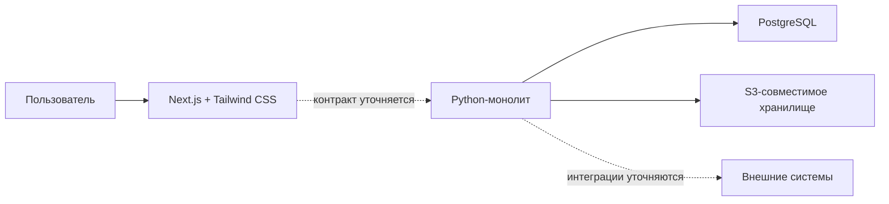

# Целевая архитектура Content Mill

## Статус

Документ фиксирует согласованные границы. В репозитории есть приложения FastAPI и Next.js, локальный Compose с PostgreSQL и отдельные [HTML-демо](../frontend-mvp/README.md). Вход, проекты и контекст клиента реализованы; документы, генерация и внешние интеграции ещё не реализованы.

## Общая форма

Серверная часть — **один монолит на Python**. Вся предметная логика находится в одной кодовой базе и развёртывается как одно приложение. Внутри монолита применяется чистая архитектура: `domain/` содержит сущности и правила, `application/` — сценарии и контракты, `infrastructure/` — реализации работы с PostgreSQL и внешними системами, `presentation/` — HTTP. Зависимости направлены внутрь: HTTP и инфраструктура используют сценарии и контракты, а сценарии не импортируют FastAPI и SQLAlchemy. Папки могут расширяться по предметным областям без отдельных процессов, сетевых контрактов и баз данных.

Схема PostgreSQL определяется моделями SQLAlchemy в `infrastructure/database/models.py` и изменяется миграциями Alembic. Миграции генерируются из метаданных моделей, проверяются вручную и применяются до запуска приложения. Raw SQL в коде приложения и тестах не используется. Репозитории реализуют контракты сценариев; транзакция задаётся Unit of Work.

Интерфейс — отдельное приложение **Next.js с Tailwind CSS**. Next.js обслуживает страницы и серверный рендеринг интерфейса; Python остаётся основной серверной частью платформы. Первый этап и границы фронтенда описаны в [роадмапе](frontend-roadmap.md), серверные решения — в [основе бэкенда](backend-foundation.md), REST-контракт — в [проекте API](api-schema.md). Для входа выбраны локальная учётная запись, access и refresh токены и браузерные HttpOnly cookie.

Для хранения всех данных пользователей, включая аккаунты, проекты, контекст, метаданные файлов, права и сессии, выбран PostgreSQL. Содержимое всех документов и медиафайлов хранится в S3-совместимом объектном хранилище. Дерево папок виртуальное: переименование не перемещает объекты. Подробности пользовательского сценария — в [кратком роадмапе](implementation-roadmap.md). Конкретный S3-провайдер и способ доступа к данным определяются при реализации.

Для локального запуска добавлены Dockerfile приложений и один `compose.yaml`. Он запускает приложения и PostgreSQL; состав объектного хранилища зависит от отдельного решения. Docker Compose — способ запуска, а не основание дробить Python-приложение на сервисы.

## Интеграции с AI-моделями

Вызов сторонней AI-модели из предметной логики проходит через существующую абстракцию соответствующей операции (например, генерации видео). Новая модель реализует этот контракт адаптером; код сценария не зависит от SDK, API и формата ответа конкретного провайдера. Если нужной абстракции пока нет, определяем её вместе с первой реализацией по фактическому сценарию. Общий контракт описывает вход, результат, ошибки и необходимые возможности; различия моделей, включая ограничения и асинхронные задачи, обрабатываются в адаптерах и при выборе модели, а не скрываются условными ветками в сценарии.

**Одна модель — один отдельный Python-файл реализации.** Если подключены четыре модели генерации видео, сохраняются четыре файла с адаптерами, даже если у них один провайдер или общий SDK. Общий транспортный код можно переиспользовать, но нельзя объединять реализации моделей в один файл с переключением по имени. При отключении модели её файл реализации и карточка в [`docs/integrations/`](integrations/README.md) остаются в репозитории; отключается выбор модели для новых задач. Исторические записи продолжают содержать фактические названия провайдера и модели. Повторное включение требует сверки текущего API и ограничений.

До реализации каждой модели создаём отдельную Markdown-карточку `docs/integrations/<provider>-<model>.md` и проверяем её по [регламенту интеграций](integrations/README.md). Карточка содержит подтверждённые ограничения промпта, размера запроса и ответа с файлами, форматы, API и известные особенности. Решение о конкретном размещении адаптеров внутри `backend/` принимается вместе с кодом; это не вводит отдельные приложения или сервисы.

## Структура репозитория

| Путь | Состояние | Назначение |
| --- | --- | --- |
| `AGENTS.md`, `README.md`, `docs/` | Есть | Правила, обзор и документация. |
| `frontend-mvp/index.html`, `frontend-mvp/assets/`, `frontend-mvp/js/`, `frontend-mvp/styles.css` | Есть | Основное автономное демо с моками. |
| `frontend-mvp/legacy.html` | Есть | Прежний однофайловый MVP. |
| `backend/src/` | Есть | Единое FastAPI-приложение, вход, база данных, зависимости и Dockerfile. |
| `backend/tests/` | Есть | Проверки доступности API, входа, проектов и контекста. |
| `frontend/` | Есть | Next.js с TypeScript, Tailwind CSS, входом и проектами. |
| `compose.yaml`, Dockerfile, `infra/` | Есть | Локальный запуск приложений и PostgreSQL; место для будущих инфраструктурных конфигураций. |

Текущая структура приложений и назначение папок описаны в [README](../README.md). Новые предметные папки добавляются вместе с реальным кодом и контрактами. Слои остаются внутри одного приложения.

## Отложенные решения

Для входа выбраны FastAPI, SQLAlchemy ORM с драйвером Psycopg, Alembic, локальная проверка пароля Argon2id, случайные непрозрачные токены и HttpOnly cookie через Next.js. Пока не выбраны фоновые задачи, конкретный S3-провайдер, AI-модели и деплой за пределами локального Compose. Соцсети и остальные продуктовые направления отложены. Их нужно решать по задачам и обновлять документацию вместе с реализацией.

Продуктовые сценарии из [функциональной спецификации](features-description.md) и [карты экранов](screens.md) описывают желаемое поведение. [MVP](mvp.md) описывает существующий независимый прототип на моковых данных.
