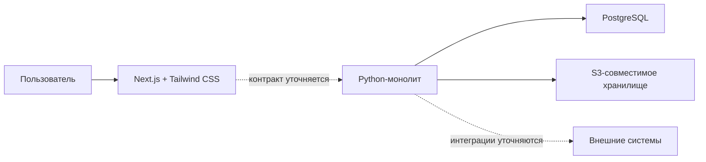

# Целевая архитектура Content Mill

## Статус

Документ фиксирует согласованные границы. В репозитории есть минимальные приложения FastAPI и Next.js, локальный Compose и отдельные [HTML-демо](../frontend-mvp/README.md). Продуктовые функции и интеграции ещё не реализованы.

## Общая форма

Серверная часть — **один монолит на Python**. Вся серверная предметная логика находится в одной кодовой базе и развёртывается как одно приложение. Разделять её на микросервисы, отдельные бизнес-модули, пакеты по доменам или собственные базы данных по функциям не планируется. Внутреннее разбиение файлов допускается для удобства чтения и поддержки, без самостоятельных контрактов между частями приложения.

Интерфейс — отдельное приложение **Next.js с Tailwind CSS**. Next.js обслуживает страницы и серверный рендеринг интерфейса; Python остаётся основной серверной частью платформы. Предлагаемый REST-контракт границы описан в [проекте API](api-schema.md); способ аутентификации и детали реализации пока не закреплены.

Для хранения базы знаний выбраны PostgreSQL для структуры и метаданных и S3-совместимое объектное хранилище для содержимого файлов. Дерево папок виртуальное: переименование не перемещает объекты. Подробности пользовательского сценария — в [кратком роадмапе](implementation-roadmap.md). Конкретный S3-провайдер и способ доступа к данным определяются при реализации.

Для локального запуска добавлены Dockerfile приложений и один `compose.yaml`. Пока он запускает только два приложения; состав контейнеров хранения зависит от отдельного решения. Docker Compose — способ запуска, а не основание дробить Python-приложение на сервисы.

## Структура репозитория

| Путь | Состояние | Назначение |
| --- | --- | --- |
| `AGENTS.md`, `README.md`, `docs/` | Есть | Правила, обзор и документация. |
| `frontend-mvp/index.html`, `frontend-mvp/assets/`, `frontend-mvp/js/`, `frontend-mvp/styles.css` | Есть | Основное автономное демо с моками. |
| `frontend-mvp/legacy.html` | Есть | Прежний однофайловый MVP. |
| `backend/` | Есть | Каркас единого FastAPI-приложения. |
| `frontend/` | Есть | Каркас Next.js с TypeScript и Tailwind CSS. |
| `tests/` | Есть | Проверка доступности API. |
| `compose.yaml`, Dockerfile, `infra/` | Есть | Локальный запуск двух приложений и место для инфраструктурных конфигураций. |

Текущая структура приложений и назначение папок описаны в [README](../README.md). Новые папки добавляются вместе с реальным кодом. Не вводи заранее схему `auth/`, `payments/`, `notifications/` или подобные модули из другого проекта.

## Отложенные решения

Для начального каркаса выбран FastAPI. Пока не выбраны способ доступа к PostgreSQL, окончательная версия предложенного API-контракта, авторизация, очереди и фоновые задачи, конкретный S3-провайдер, интеграции с AI и соцсетями, деплой за пределами локального Compose. Их нужно решать по задачам и обновлять документацию вместе с реализацией.

Продуктовые сценарии из [функциональной спецификации](features-description.md) и [карты экранов](screens.md) описывают желаемое поведение. [MVP](mvp.md) описывает существующий независимый прототип на моковых данных.
