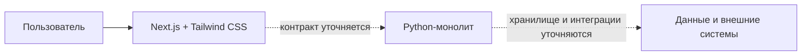

# Целевая архитектура Content Mill

## Статус

Документ фиксирует только согласованные границы. Сейчас в репозитории есть [однофайловый прототип](../frontend-mvp/index.html) и документация. Каталоги приложения, инфраструктура и реальные интеграции ещё не реализованы.

## Общая форма

Серверная часть — **один монолит на Python**. Вся серверная предметная логика находится в одной кодовой базе и развёртывается как одно приложение. Разделять её на микросервисы, отдельные бизнес-модули, пакеты по доменам или собственные базы данных по функциям не планируется. Внутреннее разбиение файлов допускается для удобства чтения и поддержки, без самостоятельных контрактов между частями приложения.

Интерфейс — отдельное приложение **Next.js с Tailwind CSS**. Next.js обслуживает страницы и серверный рендеринг интерфейса; Python остаётся основной серверной частью платформы. Граница и способ обмена данными между ними будут определены позже.

Для локального запуска предполагаются Dockerfile приложений и один `compose.yaml`. Состав дополнительных контейнеров будет зависеть от выбора хранения данных и иных требований. Docker Compose — способ запуска, а не основание дробить Python-приложение на сервисы.

## Структура репозитория

| Путь | Состояние | Назначение |
| --- | --- | --- |
| `AGENTS.md`, `README.md`, `docs/` | Есть | Правила, обзор и документация. |
| `frontend-mvp/index.html` | Есть | Автономный демонстрационный интерфейс с моками. |
| `backend/` | Планируется | Python-монолит. |
| `frontend/` | Планируется | Next.js-интерфейс и Tailwind CSS. |
| `tests/` | Планируется | Проверки по мере реализации. |
| `compose.yaml`, Dockerfile | Планируется | Локальный контейнерный запуск. |

Папки и файлы внутри будущих приложений определяются при их создании по реальному коду. Не вводи заранее схему `auth/`, `payments/`, `notifications/` или подобные модули из другого проекта.

## Отложенные решения

Пока не выбраны веб-фреймворк Python, база данных и способ доступа к ней, формат и маршруты API, авторизация, очереди и фоновые задачи, хранение медиа, интеграции с AI и соцсетями, деплой за пределами локального Compose. Их нужно решать по задачам и обновлять документацию вместе с реализацией.

Продуктовые сценарии из [функциональной спецификации](features-description.md) и [карты экранов](screens.md) описывают желаемое поведение. [MVP](mvp.md) описывает существующий независимый прототип на моковых данных.
