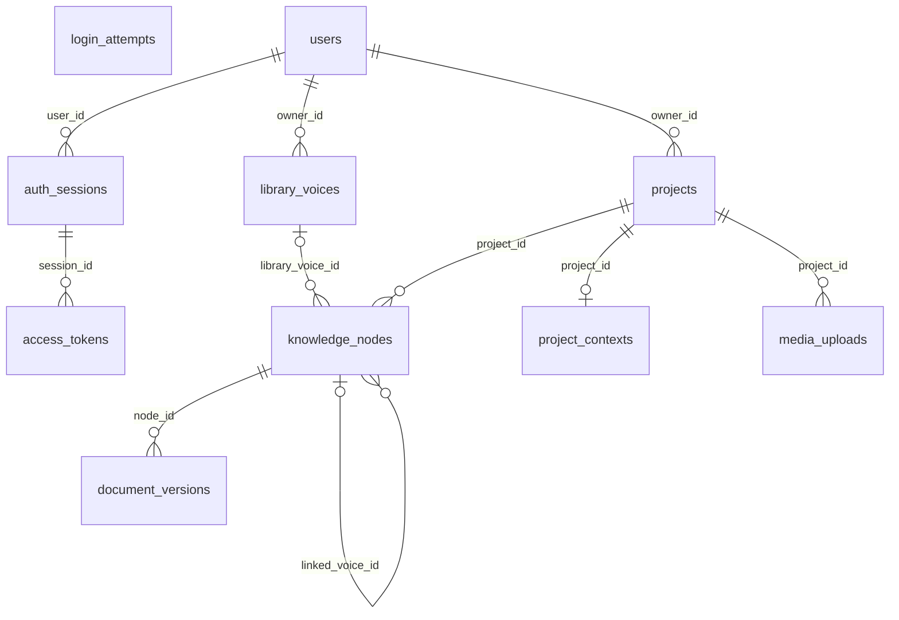

# Схема базы данных Content Mill

PostgreSQL хранит учётные записи, проекты, дерево базы знаний и метаданные файлов. Содержимое версий хранится в S3 по ключу `document_versions.storage_key`. Структуру задают [модели SQLAlchemy](../backend/src/app/infrastructure/database/models.py), историю изменений ведёт [Alembic](../backend/src/migrations/versions/).

## Связи таблиц

Подписи линий указывают поле внешнего ключа в дочерней таблице. Таблица `login_attempts` хранит попытки входа по `attempt_key` независимо от наличия учётной записи.

У корневого узла `parent_id` пуст. Поле `linked_voice_id` связывает аватар с папкой голоса. Список `project_contexts.source_version_ids` содержит идентификаторы выбранных версий документов в JSONB. Для этого списка и для полей `media_uploads.parent_id` и `media_uploads.node_id` внешние ключи в БД не заданы.

## Поля и ограничения

PK обозначает первичный ключ, FK — внешний ключ. Типы указаны для PostgreSQL.

### `users`

| Поле | Тип | Допускает NULL | Ключ |
| --- | --- | --- | --- |
| `id` | `uuid` | нет | PK |
| `email` | `varchar(254)` | нет | UNIQUE |
| `display_name` | `text` | нет | — |
| `password_hash` | `text` | нет | — |
| `created_at` | `timestamp with time zone` | нет | — |

### `auth_sessions`

| Поле | Тип | Допускает NULL | Ключ |
| --- | --- | --- | --- |
| `id` | `uuid` | нет | PK |
| `user_id` | `uuid` | нет | FK → `users.id` |
| `family_id` | `uuid` | нет | — |
| `refresh_hash` | `text` | нет | UNIQUE |
| `expires_at` | `timestamp with time zone` | нет | — |
| `revoked_at` | `timestamp with time zone` | да | — |
| `rotated_at` | `timestamp with time zone` | да | — |
| `created_at` | `timestamp with time zone` | нет | — |

Индекс `auth_sessions_family_idx` по полям `family_id`.

### `access_tokens`

| Поле | Тип | Допускает NULL | Ключ |
| --- | --- | --- | --- |
| `token_hash` | `text` | нет | PK |
| `session_id` | `uuid` | нет | FK → `auth_sessions.id` |
| `expires_at` | `timestamp with time zone` | нет | — |

### `login_attempts`

| Поле | Тип | Допускает NULL | Ключ |
| --- | --- | --- | --- |
| `id` | `uuid` | нет | PK |
| `attempt_key` | `text` | нет | — |
| `attempted_at` | `timestamp with time zone` | нет | — |

Индекс `login_attempts_key_idx` по полям `attempt_key, attempted_at`.

### `projects`

| Поле | Тип | Допускает NULL | Ключ |
| --- | --- | --- | --- |
| `id` | `uuid` | нет | PK |
| `owner_id` | `uuid` | нет | FK → `users.id` |
| `name` | `varchar(160)` | нет | — |
| `revision` | `integer` | нет | — |
| `created_at` | `timestamp with time zone` | нет | — |

Индекс `projects_owner_created_idx` по полям `owner_id, created_at, id`.

### `project_contexts`

| Поле | Тип | Допускает NULL | Ключ |
| --- | --- | --- | --- |
| `project_id` | `uuid` | нет | PK, FK → `projects.id` |
| `revision` | `integer` | нет | — |
| `description` | `text` | нет | — |
| `audiences` | `jsonb` | нет | — |
| `products` | `jsonb` | нет | — |
| `facts` | `jsonb` | нет | — |
| `tone_of_voice` | `text` | нет | — |
| `forbidden_terms` | `jsonb` | нет | — |
| `source_version_ids` | `jsonb` | нет | — |

### `knowledge_nodes`

| Поле | Тип | Допускает NULL | Ключ |
| --- | --- | --- | --- |
| `id` | `uuid` | нет | PK |
| `project_id` | `uuid` | нет | FK → `projects.id` |
| `parent_id` | `uuid` | да | FK → `knowledge_nodes.id` |
| `kind` | `varchar(16)` | нет | — |
| `name` | `varchar(160)` | нет | — |
| `revision` | `integer` | нет | — |
| `created_at` | `timestamp with time zone` | нет | — |
| `archived_at` | `timestamp with time zone` | да | — |
| `folder_role` | `varchar(32)` | да | — |
| `description` | `text` | да | — |
| `elevenlabs_voice_id` | `varchar(160)` | да | — |
| `library_voice_id` | `uuid` | да | FK → `library_voices.id` |
| `linked_voice_id` | `uuid` | да | FK → `knowledge_nodes.id` |
| `voice_gender` | `varchar(16)` | да | — |
| `catalog_languages` | `jsonb` | да | — |
| `voice_preview_url` | `text` | да | — |
| `voice_language` | `varchar(80)` | да | — |
| `voice_model` | `varchar(160)` | да | — |

Индекс `knowledge_nodes_project_parent_idx` по полям `project_id, parent_id`.

### `document_versions`

| Поле | Тип | Допускает NULL | Ключ |
| --- | --- | --- | --- |
| `id` | `uuid` | нет | PK |
| `node_id` | `uuid` | нет | FK → `knowledge_nodes.id` |
| `version` | `integer` | нет | — |
| `format` | `varchar(16)` | нет | — |
| `size_bytes` | `integer` | нет | — |
| `sha256` | `varchar(64)` | нет | — |
| `storage_key` | `text` | нет | UNIQUE |
| `search_text` | `text` | да | — |
| `created_at` | `timestamp with time zone` | нет | — |

Уникальный индекс `document_versions_node_version_idx` по полям `node_id, version`.

### `media_uploads`

| Поле | Тип | Допускает NULL | Ключ |
| --- | --- | --- | --- |
| `id` | `uuid` | нет | PK |
| `project_id` | `uuid` | нет | FK → `projects.id` (ON DELETE CASCADE) |
| `parent_id` | `uuid` | да | — |
| `node_id` | `uuid` | да | — |
| `revision` | `integer` | да | — |
| `name` | `varchar(160)` | нет | — |
| `mime_type` | `varchar(64)` | нет | — |
| `size_bytes` | `integer` | нет | — |
| `sha256` | `varchar(64)` | нет | — |
| `expires_at` | `timestamp with time zone` | нет | — |
| `completed_version` | `integer` | да | — |

Индекс `ix_media_uploads_expires_at` по полям `expires_at`.

### library_voices

Личные голоса. Первичный ключ `id` (UUID), владелец `owner_id` (обязательный индексированный FK на users с каскадным удалением), обязательное имя `name` (varchar 160). Необязательные поля: `description` и `voice_preview_url` (text), `elevenlabs_voice_id` и `voice_model` (varchar 160), `voice_gender` (varchar 16), `voice_language` (varchar 80), `catalog_languages` (jsonb). Индекс по knowledge_nodes.library_voice_id используется при чтении назначений.

## Ролики проекта

Таблица `videos` привязана к `projects.id` через индексированный `project_id`. В строке хранятся название, статус, дата создания, текст сценария, подпись и монтажный лист. Поле `settings` содержит параметры мастера, снимок ссылок на выбранные версии базы знаний и время демо-публикации. Объект `settings.production` хранит этап сборки, номер сцены, ID заказа провайдера и сохранённых версий. Поле `ready_at` определяет время следующего этапа или истечения аренды. В прежних демо-записях оно задавало время окончания демонстрации. Удаление проекта каскадно удаляет его ролики.

## Токен доступа агента

В `project_agent_tokens` первичный ключ `project_id` ограничивает проект одним токеном. `owner_id` ссылается на пользователя, `token_hash` хранит уникальный SHA-256, `expires_at` задаёт срок доступа. Удаление проекта или владельца каскадно удаляет токен.

## Заказы озвучки

В `library_voices.lumean_template_id` хранится UUID повторно используемого шаблона. Таблица `speech_jobs` содержит локальный UUID запроса, внешний ключ на личный голос с каскадным удалением, SHA-256 текста, статус отправки, уникальный UUID внешнего заказа и время создания. Владельца определяет карточка голоса.

Таблица `script_jobs` хранит владельца, проект, модель, бриф, плановое и фактическое начало, статус и результат генерации. Индексы обслуживают очередь по статусу и времени запуска и историю проекта. [Серверная подготовка сценариев](decisions/0013-managed-scripts.md)

Таблица `avatar_workspaces` связывает владельца (первичный ключ owner_id → users.id) с единственным закрытым пространством его личных аватаров (уникальный project_id → projects.id). Папки, содержимое и версии используют существующие knowledge_nodes, document_versions и проектные ключи S3. Проектное назначение создаёт самостоятельную копию. [Решение](decisions/0021-avatar-cast.md).

Поле knowledge_nodes.library_avatar_id ссылается на исходную папку в личной библиотеке. Повторное назначение возвращает уже существующую проектную копию.
